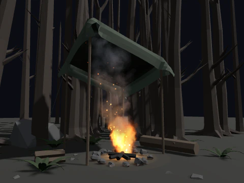
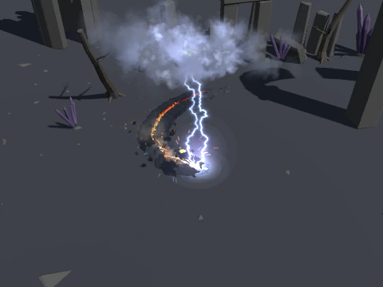
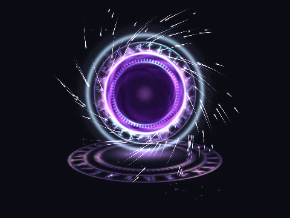
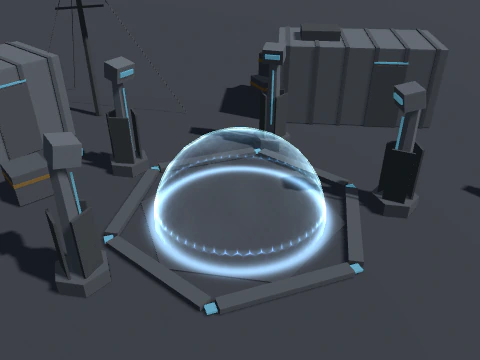
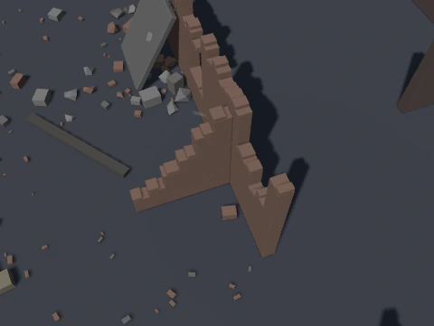
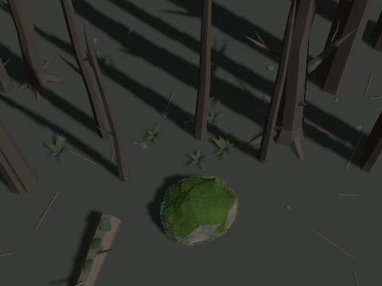
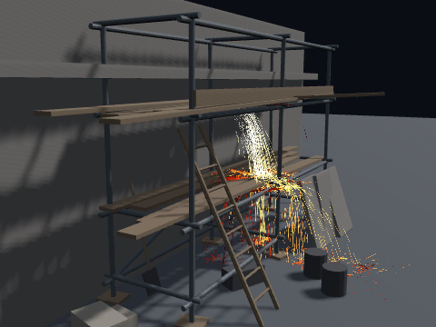
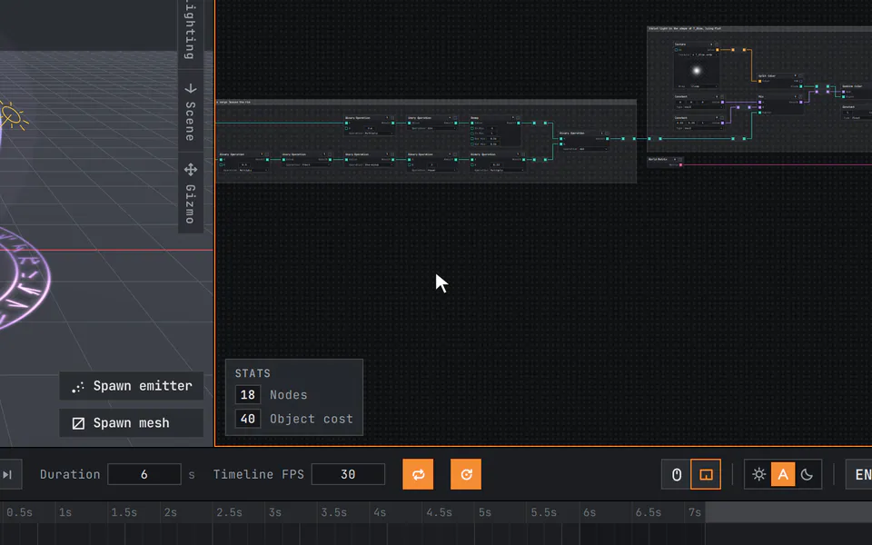

#  Sparcoon Editor

A browser-based node editor for three.js particle effects. The result is a TypeScript module played
by the [`sparcoon`](https://github.com/jango-git/sparcoon) runtime.

**[Open the editor](https://jango-git.github.io/sparcoon-editor/)** -
[Runtime](https://github.com/jango-git/sparcoon) -
[npm](https://www.npmjs.com/package/sparcoon)

<table>
  <tr>
    <td align="center"><br /><b>Campfire</b><br /><sub>flipbook, Half-Lit, ground collision</sub></td>
    <td align="center"><br /><b>Lightning Crack</b><br /><sub>mesh particles, shadows, soft particles</sub></td>
  </tr>
  <tr>
    <td align="center"><br /><b>Portal</b><br /><sub>vortex, soft particles</sub></td>
    <td align="center"><br /><b>Energy Shield</b><br /><sub>sphere collision, death reactions, trails</sub></td>
  </tr>
  <tr>
    <td align="center"><br /><b>Fireworks</b><br /><sub>chained reactions, inherited color, trails</sub></td>
    <td align="center"><br /><b>Destruction</b><br /><sub>mesh particles, shadows, lighting, collisions</sub></td>
  </tr>
  <tr>
    <td align="center"><br /><b>Fireflies</b><br /><sub>spawn on a mesh, curl noise</sub></td>
    <td align="center"><br /><b>Sparks</b><br /><sub>GPU simulation, collision, shadows</sub></td>
  </tr>
  <tr>
    <td colspan="2" align="center"><br /><b>Portal in the editor</b></td>
  </tr>
</table>

Every effect above is an editor preset. To open one, press `Ctrl+Space`, pick it on the **Content**
screen and press **Load**.

> **Pre-release.** The project and export formats still change. Projects from earlier versions open
> in the current one (see [Projects](#projects)).

## Purpose

The editor targets effects for mobile ads and playables, where the build size is limited, devices
are old and code generation at runtime is forbidden. Graphs compile into shaders and simulation code
as you work, and only the result goes into the game.

It is not a fit if you need a 3D scene editor, effects assembled from data at runtime, or another
engine (Babylon.js, PlayCanvas, PixiJS).

## Quick start

1. Open the [editor](https://jango-git.github.io/sparcoon-editor/).
2. `Ctrl+Space`, the **Content** screen, the **Sparks** preset, **Load**.
3. Close the screen and press `Space`.
4. Change a node value or an event on the timeline.
5. **Content**, **Export TypeScript**.

## What an effect is made of

An effect is a root **VFX group** and the objects in it:

- **Emitter** - a particle system with a behavior graph (how particles are born and move), a render
  graph (how they look), and optional trail and ribbon graphs: a band behind every particle, and a
  band through the particles in the order they were born.
- **VFX mesh** - a single mesh with a render graph, for example a shockwave, a shield or a scene
  object.

Every graph ends in sinks, the nodes its results flow into:

- **Spawn** - values at a particle's birth: position, velocity, lifetime, attributes. The emitter's
  capacity and GPU simulation are set here too.
- **Update** - values at every simulation step, and killing a particle, for example when it touches
  a collider.
- **Surface** - color, particle shape (billboard, primitive or mesh), blend mode, sorting and
  shadows. With Draw Particles off the particles are simulated but not drawn, for an emitter shown
  by its trail or ribbon alone.
- **Surface** of a trail graph - the band's color and width, its length and how often it records a
  point.
- **Surface** of a ribbon graph - the band's color and width, and how its UV runs along it: each
  point's age over its lifetime, or a repeat every few particles. A ribbon joins each particle to
  the one born right after it, so it follows one stream of births, as a play makes; bursts of
  several particles and reactions weave it between them. With Head on, while a play emits, the
  ribbon reaches on to the particle a birth would seed now, so it does not lag behind a moving
  emitter.

If a material does not fit the device limits, its graph is marked with an error for WebGL2 or a
warning for WebGL1.

## Timeline

The timeline sets everything that depends on time:

- **Burst** - a release of particles on one frame.
- **Play** - continuous emission per second or per unit the emitter travels.
- Keys on the transform of any object and on graph parameters (**Timeline Value**).
- **Loop** - looping or one-shot playback.

A channel marked **Exclude from export** stays out of the export, and the game's code sets its
value.

## Reactions and inheritance

A reaction starts emission on one emitter where another emitter's particles are born or die.
Firework bursts, impact splashes and multi-stage chains are built this way. A reaction is added on
the emitter's timeline with **Add reaction**, and its **Event** (birth or death) can be switched in
the inspector.

- The reaction fires at the point of birth or death, one frame later.
- The source emitter simulates on the CPU.
- An emitter cannot react to itself, and reactions cannot form a cycle, whatever their events.

The **Inherited Attribute** node hands a newborn particle an attribute of the source particle:
color, size, random seed, any attribute of its emitter. At a birth the source particle holds only
what its spawn wrote, and an attribute written only in the update keeps the default with a warning.
If the particle was not born from a reaction, the node returns its default value.

## Nodes

- **Behavior:** random points in shapes and on mesh surfaces, forces (gravity, drag, point force,
  vortex, turbulence), collisions (plane, box, sphere, cone, a surface given by a distance field),
  the distance and normal to a mesh from its SDF and to the rendered scene from its depth (Depth
  Sample), particle attributes.
- **Render:** textures and flipbooks, UV transforms, gradients, color correction, fresnel, dissolve,
  soft particles (Depth Fade), lighting (Lambert, Half-Lit, ambient), normal maps, particle
  orientation.
- **Shared:** math, curves, noise (value, fractal, curl, Voronoi), random numbers.

Every node shows an approximate cost in GPU operations - for comparing graphs, not for estimating
frame time.

## Rendering and simulation

Every graph compiles for two tiers, **Standard** (WebGL2) and **Baseline** (WebGL1). The preview
switches between them, and the export carries both. The node set is the same, but the quality of
some nodes depends on the tier.

An emitter simulates on the GPU if that is enabled (the default), the graph allows it and the device
supports it, and on the CPU otherwise.

Depth Fade and Depth Sample read the depth of the opaque scene. In the preview that is the studio
ground as the viewport camera sees it. In a game it is the depth the game gives the camera, as the
[runtime's README](https://github.com/jango-git/sparcoon#scene-depth) shows. Depth Sample collides
only in the GPU simulation. On the CPU it finds no surface, and the node is marked with a warning.

## Assets and preview

- Images become textures, `.glb` and `.gltf` become meshes, `.hdr` becomes a preview environment.
- Only geometry is taken from a `.glb`, one asset per mesh. The material comes from the render
  graph.
- A mesh bakes into a volume, a signed distance field (SDF), on the screen its row's **Bake SDF**
  opens. A closed mesh bakes as a solid by default, an open one as a shell. The view beside the
  settings shows the surface the bake holds, and **Add to library** keeps it.
- A volume is in the space of its mesh, so a graph moves a particle's position into that space
  before sampling it. Picking a volume in a node sets the node's box and distance encoding.
- A volume downloads as a PNG of its slices. The game builds a 3D texture from it, as the
  [runtime's README](https://github.com/jango-git/sparcoon#signed-distance-fields) shows.
- The preview is lit manually (Sun, Hemisphere) or by an HDRI environment. Preview lighting is not
  exported, and in the game the effect is lit by the lights of its scene.

## Export

- **Project JSON** - the project together with its assets, for handing to another artist.
- **TypeScript** - an effect module ready for the build. Assets are not included - the game's code
  passes them in.
- **Zip** - the library's images, meshes as `.glb` and volumes as PNGs of their slices, in one
  archive. Files are named as in the library. HDRIs are not included.

Using the effect in a game is described in the
[runtime's README](https://github.com/jango-git/sparcoon#readme).

## Projects

- A project lives in the browser and is autosaved, and `Ctrl+S` saves it as `.json`. There is no
  cloud, no share links and no accounts.
- A project from an earlier version opens in the current one. Missing fields get default values,
  renamed nodes and their renamed inputs and outputs are carried over, and a removed node stays in
  the graph with an error.
- A project saved by a later version of the editor in a newer project format does not open.
- After updating the runtime, export your effects again.

## Interface

The interface is in English, Russian and Ukrainian. A graph is laid out automatically with the
Arrange button.

| Shortcut                     | Action                           |
| ---------------------------- | -------------------------------- |
| `Ctrl+Z` / `Ctrl+Shift+Z`    | Undo / redo                      |
| `Ctrl+C` / `Ctrl+V`          | Copy / paste                     |
| `Ctrl+S`                     | Save the project as JSON         |
| `Ctrl+Space`                 | Content screen                   |
| `Space`                      | Play / pause                     |
| `Left` / `Right`             | Step one frame                   |
| `A`                          | Add node (graph)                 |
| `C`                          | Add comment (graph)              |
| `G` / `R` / `S`              | Move / rotate / scale (viewport) |
| `N`                          | Transform panel (viewport)       |
| `I`                          | Key the selection                |
| `F`                          | Fit view                         |
| `Delete` / `Backspace` / `X` | Delete selection                 |

## Agent API

The editor publishes `window.sparcoon`, an API through which an agent builds an effect in a browser
(usually headless, with calls through `page.evaluate`).

- `scene`, `graph(...)`, `timeline` - edits to objects, graphs and the timeline.
- `edit(body)` - several edits as one undo step, all or nothing.
- `catalog` - a graph's nodes with their inputs, outputs and parameters.
- `assets`, `project` - assets, projects, presets and export.
- `preview` - playback and frame captures.
- `status()` - the compile result after the last edit.

Inputs and outputs are JSON. `version` goes up on incompatible API changes.

## Development

```sh
npm install
npm run dev
npm run build
npm test
npm run typecheck
npm run lint
```

The site is built from releases. A release sets `version` in `package.json`, renames the
"Unreleased" heading of [CHANGELOG.md](CHANGELOG.md) to that version and its date and pushes the tag
`v<version>`. Pushes to `main` only run the checks.

When reporting a bug, attach a screen recording and the project `.json`.

## License

MIT. See [LICENSE](LICENSE).
