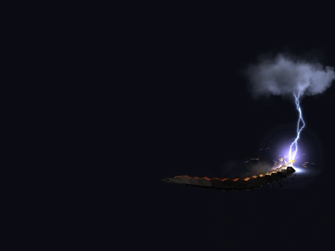
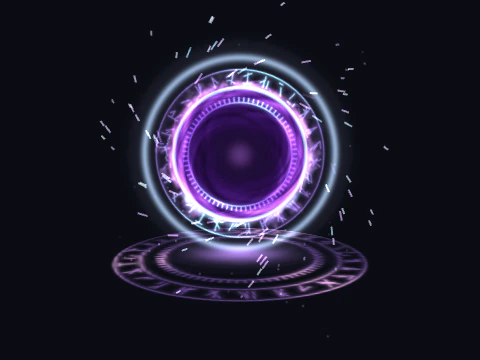
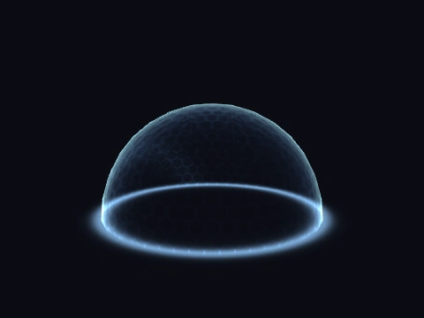
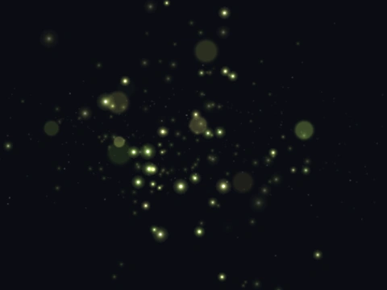
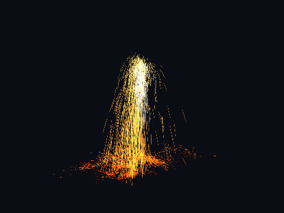
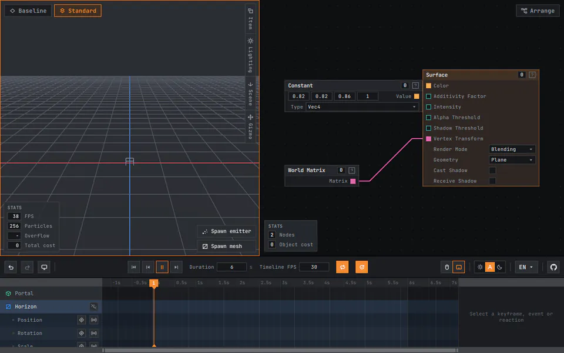

#  Sparcoon Editor

A browser-based node editor for three.js particle effects. The result is a TypeScript module played
by the [`sparcoon`](https://github.com/jango-git/sparcoon) runtime.

**[Open the editor](https://jango-git.github.io/sparcoon-editor/)** -
[Runtime](https://github.com/jango-git/sparcoon) -
[npm](https://www.npmjs.com/package/sparcoon)

<table>
  <tr>
    <td align="center"><br /><b>Campfire</b><br /><sub>flipbook, Half-Lit, ground collision</sub></td>
    <td align="center"><br /><b>Lightning Crack</b><br /><sub>mesh particles, shadows, soft particles</sub></td>
  </tr>
  <tr>
    <td align="center"><br /><b>Portal</b><br /><sub>vortex, soft particles</sub></td>
    <td align="center"><br /><b>Energy Shield</b><br /><sub>sphere collision, death reactions, trails</sub></td>
  </tr>
  <tr>
    <td align="center"><br /><b>Fireworks</b><br /><sub>chained reactions, inherited color, trails</sub></td>
    <td align="center"><br /><b>Destruction</b><br /><sub>mesh particles, shadows, lighting, collisions</sub></td>
  </tr>
  <tr>
    <td align="center"><br /><b>Fireflies</b><br /><sub>curl noise</sub></td>
    <td align="center"><br /><b>Sparks</b><br /><sub>GPU simulation, collision, shadows</sub></td>
  </tr>
  <tr>
    <td colspan="2" align="center"><br /><b>Portal in the editor</b></td>
  </tr>
</table>

Every effect above is an editor preset. To open one, press `Ctrl+Space`, pick it on the **Content**
screen and press **Load**.

> **Pre-release.** The project and export formats still change. Projects from earlier versions open
> in the current one (see [Projects](#projects)).

## Purpose

The editor targets effects for mobile ads and playables, where the build size is limited, devices
are old and code generation at runtime is forbidden. Graphs compile into shaders and simulation code
as you work, and only the result goes into the game.

It is not a fit if you need a 3D scene editor, effects assembled from data at runtime, or another
engine (Babylon.js, PlayCanvas, PixiJS).

## Quick start

1. Open the [editor](https://jango-git.github.io/sparcoon-editor/).
2. `Ctrl+Space`, the **Content** screen, the **Sparks** preset, **Load**.
3. Close the screen and press `Space`.
4. Change a node value or an event on the timeline.
5. **Content**, **Export TypeScript**.

## What an effect is made of

An effect is a root **VFX group** and the objects in it:

- **Emitter** - a particle system with a behavior graph (how particles are born and move), a render
  graph (how they look) and an optional trail graph (a ribbon behind every particle).
- **VFX mesh** - a single mesh with a render graph, for example a shockwave, a shield or a scene
  object.

Every graph ends in sinks, the nodes its results flow into:

- **Spawn** - values at a particle's birth: position, velocity, lifetime, attributes. The emitter's
  capacity and GPU simulation are set here too.
- **Update** - values at every simulation step, and killing a particle, for example when it touches
  a collider.
- **Surface** - color, particle shape (billboard, primitive or mesh), blend mode, sorting and
  shadows.
- **Surface** of a trail graph - the ribbon's color and width, its length and how often it records
  a point.

If a material does not fit the device limits, its graph is marked with an error for WebGL2 or a
warning for WebGL1.

## Timeline

The timeline sets everything that depends on time:

- **Burst** - a release of particles on one frame.
- **Play** - continuous emission per second or per unit the emitter travels.
- Keys on the transform of any object and on graph parameters (**Timeline Value**).
- **Loop** - looping or one-shot playback.

A channel marked **Exclude from export** stays out of the export, and the game's code sets its
value.

## Reactions and inheritance

A reaction starts emission on one emitter where another emitter's particles die. Firework bursts,
impact splashes and multi-stage chains are built this way. A reaction is added on the emitter's
timeline with **Add reaction**.

- The event fires at the point of death, one frame later.
- The source emitter simulates on the CPU.
- An emitter cannot react to itself, and reactions cannot form a cycle.

The **Inherited Attribute** node hands a newborn particle an attribute of the dead one: color, size,
random seed, any attribute of its emitter. If the particle was not born from a reaction, the node
returns its default value.

## Nodes

- **Behavior:** spawn shapes, forces (gravity, drag, point force, vortex, turbulence), collisions
  (plane, box, sphere, cone), particle attributes.
- **Render:** textures and flipbooks, UV transforms, gradients, color correction, fresnel, dissolve,
  soft particles (Depth Fade), lighting (Lambert, Half-Lit, ambient), normal maps, particle
  orientation.
- **Shared:** math, curves, noise (value, fractal, curl, Voronoi), random numbers.

Every node shows an approximate cost in GPU operations - for comparing graphs, not for estimating
frame time.

## Rendering and simulation

Every graph compiles for two tiers, **Standard** (WebGL2) and **Baseline** (WebGL1). The preview
switches between them, and the export carries both. The node set is the same, but the quality of
some nodes depends on the tier.

An emitter simulates on the GPU if that is enabled (the default), the graph allows it and the device
supports it, and on the CPU otherwise.

## Assets and preview

- Images become textures, `.glb` and `.gltf` become meshes, `.hdr` becomes a preview environment.
- Only geometry is taken from a `.glb`, one asset per mesh. The material comes from the render
  graph.
- The preview is lit manually (Sun, Hemisphere) or by an HDRI environment. Preview lighting is not
  exported, and in the game the effect is lit by the lights of its scene.

## Export

- **Project JSON** - the project together with its assets, for handing to another artist.
- **TypeScript** - an effect module ready for the build. Assets are not included - the game's code
  passes them in.

Using the effect in a game is described in the
[runtime's README](https://github.com/jango-git/sparcoon#readme).

## Projects

- A project lives in the browser and is autosaved, and `Ctrl+S` saves it as `.json`. There is no
  cloud, no share links and no accounts.
- A project from an earlier version opens in the current one. Missing fields get default values,
  renamed node inputs and outputs are carried over, and a removed node stays in the graph with an
  error.
- After updating the runtime, export your effects again.

## Interface

The interface is in English, Russian and Ukrainian. A graph is laid out automatically with the
Arrange button.

| Shortcut                     | Action                           |
| ---------------------------- | -------------------------------- |
| `Ctrl+Z` / `Ctrl+Shift+Z`    | Undo / redo                      |
| `Ctrl+C` / `Ctrl+V`          | Copy / paste                     |
| `Ctrl+S`                     | Save the project as JSON         |
| `Ctrl+Space`                 | Content screen                   |
| `Space`                      | Play / pause                     |
| `Left` / `Right`             | Step one frame                   |
| `A`                          | Add node (graph)                 |
| `C`                          | Add comment (graph)              |
| `G` / `R` / `S`              | Move / rotate / scale (viewport) |
| `N`                          | Transform panel (viewport)       |
| `I`                          | Key the selection                |
| `F`                          | Fit view                         |
| `Delete` / `Backspace` / `X` | Delete selection                 |

## Agent API

The editor publishes `window.sparcoon`, an API through which an agent builds an effect in a browser
(usually headless, with calls through `page.evaluate`).

- `scene`, `graph(...)`, `timeline` - edits to objects, graphs and the timeline.
- `edit(body)` - several edits as one undo step, all or nothing.
- `catalog` - a graph's nodes with their inputs, outputs and parameters.
- `assets`, `project` - assets, projects, presets and export.
- `preview` - playback and frame captures.
- `status()` - the compile result after the last edit.

Inputs and outputs are JSON. `version` goes up on incompatible API changes.

## Development

```sh
npm install
npm run dev
npm run build
npm test
npm run typecheck
npm run lint
```

When reporting a bug, attach a screen recording and the project `.json`.

## License

MIT. See [LICENSE](LICENSE).
